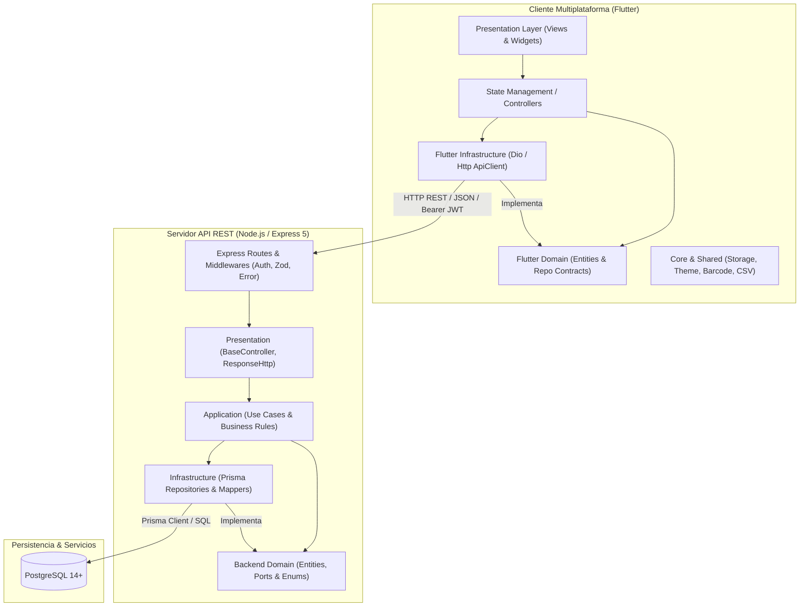
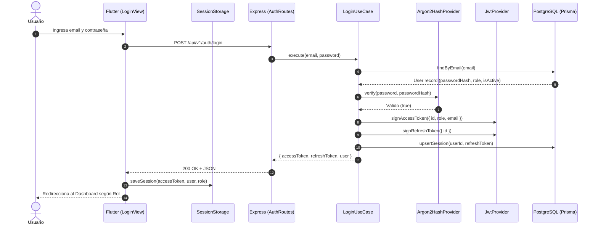
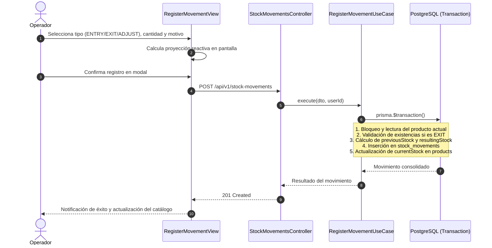

# Arquitectura Técnica del Sistema: Feature + Domain (Clean Architecture)

Este documento detalla la arquitectura de software del **Sistema de Gestión de Inventario**, abarcando tanto el **Backend (Node.js/Express/TypeScript)** como el **Frontend (Flutter/Dart)** bajo los principios de **Clean Architecture**, **Screaming Architecture (Feature-Driven)** y **Domain-Driven Design (DDD)**.

---

## 1. Principios Fundamentales de Diseño

1. **Independencia del Dominio (Core Business Logic)**:
   - El dominio (`domain`) es el núcleo puro del sistema. No depende de frameworks web, librerías de interfaz gráfica ni detalles de persistencia (ORMs, bases de datos o clientes HTTP).
2. **Dirección de Dependencias Hacia Adentro**:
   - Las capas externas (`presentation` e `infrastructure`) dependen de las capas internas (`application` y `domain`), **nunca al revés**.
3. **Modularización por Funcionalidad (Feature / Module Slice)**:
   - En lugar de agrupar todo el código en carpetas monolíticas globales (`controllers/`, `services/`, `models/`), el sistema se divide verticalmente en **features / módulos de negocio autocontenidos**. Cada módulo contiene sus propias 4 capas de Clean Architecture.
4. **Inversión de Control (Dependency Inversion Principle)**:
   - Los casos de uso y controladores dependen de contratos e interfaces (`*.repository.ts` / `*_repository.dart`), no de implementaciones concretas. La inyección de dependencias se centraliza en ensambladores modulares.
5. **Inmutabilidad y Trazabilidad**:
   - Registro atómico de inventario en transacciones aisladas y borrado lógico (`isActive: false`) para asegurar auditoría e integridad referencial.

---

## 2. Visión Global de la Arquitectura



---

## 3. Arquitectura del Backend (`backend/`)

El backend reside en `backend/` y utiliza **Node.js**, **Express 5**, **TypeScript 5.9 (ESM)** y **Prisma ORM 6.19**.

### 3.1. Estructura de Directorios

```text
backend/
├── prisma/
│   ├── schema.prisma            # Esquema declarativo de base de datos
│   ├── migrations/              # Migraciones versionadas en SQL
│   └── seed.ts                  # Semilla de datos inicial (Admin, Operador, Categoría)
└── src/
    ├── app.ts                   # Configuración del servidor Express y middlewares globales
    ├── server.ts                # Punto de entrada HTTP y arranque de puerto
    ├── app/
    │   ├── http/response.http.ts         # Formato estándar de respuesta JSON (Respuesta.exito / paginacion)
    │   └── middleware/                   # Middlewares globales:
    │       ├── Auth.middleware.ts        # routeProtect (Bearer JWT) y checkRole (RBAC)
    │       ├── Validated.middleware.ts   # Interceptor de esquemas de validación Zod
    │       └── Error.middleware.ts       # Capturador global de excepciones y mapeo de AppError
    ├── routes/
    │   └── index.routes.ts      # Enrutador principal que monta los submódulos en /api/v1
    ├── shared/                  # Utilidades compartidas y proveedores de infraestructura transversal
    │   ├── config/env.config.ts # Tipado y carga de variables de entorno
    │   ├── errors/AppError.ts   # Clase base estandarizada de errores operacionales HTTP
    │   ├── logger/logger.ts     # Logger del sistema
    │   ├── domain/              # Tipos genéricos de paginación y contratos compartidos
    │   └── infrastructure/      # Proveedores de hash (Argon2) y JWT (jose)
    └── modules/                 # Modularización vertical por dominio de negocio (Feature Slices)
        ├── Auth/                # Autenticación, tokens JWT y sesiones
        ├── Users/               # Gestión de usuarios y control de roles
        ├── Categories/          # Categorías taxonómicas de inventario
        ├── Products/            # Catálogo de productos, códigos únicos y etiquetas
        └── StockMovements/      # Transacciones y movimientos atómicos de stock
```

### 3.2. Las 4 Capas de Clean Architecture en Cada Módulo

Cada subdirectorio dentro de `backend/src/modules/<Modulo>/` contiene estrictamente las cuatro capas:

#### 1. 📁 `domain/` (Capa de Dominio)
- **Propósito**: Contiene los contratos puros, tipos de datos y modelos de negocio sin dependencias tecnológicas externas.
- **Contenido**:
  - `*.entity.ts`: Entidades y tipos de datos puros de TypeScript (ej. `Product`, `CreateProductDTO`, `Category`).
  - `*.repository.ts`: Interfaz abstracta que define el contrato de persistencia (ej. `ProductsRepository`).
- **Regla inquebrantable**: Prohibido importar `@prisma/client`, `express` o librerías de infraestructura dentro de `domain/`.

#### 2. 📁 `application/` (Capa de Aplicación / Casos de Uso)
- **Propósito**: Implementa y orquesta los casos de uso individuales del negocio.
- **Contenido**:
  - `*.usecase.ts`: Una clase por caso de uso (ej. `CreateProductUseCase`, `RegisterMovementUseCase`, `ListProductsUseCase`).
- **Reglas**:
  - Recibe los repositorios mediante inyección por constructor tipados con la interfaz del dominio (`private productsRepository: ProductsRepository`).
  - Aplica validaciones de reglas de negocio complejas (existencia previa, validación de stock disponible, códigos duplicados).
  - Lanza excepciones controladas utilizando la clase de dominio `AppError(status, message)`.

#### 3. 📁 `infrastructure/` (Capa de Infraestructura)
- **Propósito**: Implementa los contratos definidos en `domain/` contra tecnologías específicas (Prisma ORM, bases de datos relacionales, APIs externas).
- **Contenido**:
  - `prisma-*.repository.ts`: Implementación concreta de las interfaces del dominio utilizando `PrismaClient` (ej. `PrismaProductsRepository`).
  - `*.mapper.ts`: Mappers que transforman los registros nativos de Prisma en entidades de dominio puras.
  - `prisma-error.mapper.ts`: Traduce errores de base de datos (códigos únicos `P2002`, llaves foráneas `P2003`) a excepciones legibles.

#### 4. 📁 `presentation/` (Capa de Presentación)
- **Propósito**: Exposición del servicio mediante controladores y rutas HTTP.
- **Contenido**:
  - `*.controller.ts`: Extiende de `BaseController`. Extrae parámetros (`req.body`, `req.params`, `req.query`, `res.locals.user`), invoca el caso de uso y formatea la salida mediante `Respuesta.exito(res, data)` o `Respuesta.paginacion(res, data)`.
  - `*.routes.ts`: Definición de endpoints con Express `Router()`, aplicando `AuthMiddleware.routeProtect`, `AuthMiddleware.checkRole([Role.ADMIN])` y `ValidarMiddleware.body(schema)`.
  - `validators/*.schema.ts`: Esquemas de validación de sintaxis y tipos con **Zod**.

### 3.3. Ensamblado e Inyección de Dependencias (`<modulo>.module.ts`)

Para evitar acoplamientos, cada módulo expone un archivo de cableado (ej. `products.module.ts`):
```text
[PrismaClient] ──> [PrismaProductsRepository] ──> [ProductsUseCases] ──> [ProductsController] ──> [ProductsRoutes]
```
De esta manera, el controlador no sabe que existe Prisma, y el caso de uso puede ser probado de forma unitaria reemplazando el repositorio con un mock en memoria.

---

## 4. Arquitectura del Frontend (`frontend/` Flutter)

La aplicación cliente para Web, macOS y dispositivos móviles está desarrollada en **Flutter (Dart 3.13+)**, aplicando de manera simétrica **Clean Architecture** estructurada bajo la carpeta oficial **`features/`**.

### 4.1. Estructura de Directorios

```text
frontend/lib/
├── main.dart                    # Punto de entrada de la aplicación y TabScaffold
├── core/                        # Núcleo técnico reutilizable en toda la app
│   ├── constants/
│   │   └── api_endpoints.dart   # Catálogo unificado de URLs con detección de host
│   ├── network/
│   │   └── api_client.dart      # Cliente HTTP con Bearer token automático y normalización de errores
│   ├── storage/
│   │   └── session_storage.dart # Persistencia en disco (SharedPreferences) de sesión y rol
│   └── theme/
│       ├── cupertino_theme.dart # Configuración visual según Apple Human Interface Guidelines
│       └── app_theme.dart       # Paleta cromática corporativa y tipografías
├── shared/                      # Componentes y utilidades transversales
│   ├── widgets/
│   │   ├── barcode_widget.dart  # CustomPainter nativo para Code 128 y código QR puro
│   │   └── cupertino_components.dart # CupertinoCard, StatCard, EmptyState, LoadingState
│   └── utils/
│       ├── csv_downloader.dart  # Exportador directo multiplataforma (Web Blob / Dart IO)
│       ├── csv_downloader_platform_web.dart
│       ├── csv_downloader_platform_io.dart
│       └── csv_downloader_platform_stub.dart
└── features/                    # Módulos organizados por funcionalidad (Feature-Driven)
    ├── auth/                    # Iniciar sesión, cerrar sesión, verificar perfil
    ├── dashboard/               # Métricas clave (KPIs), valoración económica, accesos rápidos
    ├── categories/              # Listado y creación de categorías de inventario
    ├── products/                # Catálogo, fichas técnicas, generación de código, etiquetas
    ├── scanner/                 # Escáner de cámara en vivo con mobile_scanner
    ├── stock_movements/         # Registro atómico de movimientos y auditoría de kárdex
    └── users/                   # Perfil y cambio de contraseña
```

### 4.2. Estructura Interna de Cada Feature en Flutter

Cada módulo en `frontend/lib/features/<feature>/` replica la división de responsabilidades:

```text
features/<feature>/
├── domain/                      # Modelos de datos inmutables y contratos de repositorios
│   ├── <model>.dart             # Modelo con factory fromJson / toJson
│   └── <feature>_repository.dart# Contrato abstracto (interfaz pura en Dart)
├── infrastructure/              # Implementaciones con ApiClient
│   └── <feature>_repository_impl.dart # Llamadas HTTP a endpoints de la API
└── presentation/
    ├── controllers/             # Manejadores de estado (ChangeNotifier / State)
    ├── views/                   # Pantallas principales (*_view.dart)
    └── widgets/                 # Componentes visuales desacoplados en piezas pequeñas
```

### 4.3. Regla de Oro en Presentation: Modularización de Vistas y Widgets

Para evitar vistas monolíticas ("God Views") de cientos de líneas, cada pantalla delega su interfaz en widgets atómicos dentro de su carpeta `widgets/`:
- **Dashboard**: `dashboard_header.dart`, `dashboard_kpi_cards.dart`, `quick_actions_grid.dart`, `low_stock_section.dart`.
- **Productos**: `product_card.dart` (con soporte para `imageUrl`, indicador de carga y fallback), `product_search_bar.dart`, `product_label_card.dart`, `product_options_sheet.dart`, `category_form_modal.dart`.
- **Escáner**: `scanner_viewfinder.dart`, `scanner_reticle_painter.dart`, `scanner_action_sheets.dart`.
- **Movimientos**: `movement_item_card.dart`, `realtime_projection_card.dart`, `movement_type_selector.dart`.

---

## 5. Flujos de Datos Clave de la Arquitectura

### 5.1. Ciclo de Autenticación y Autorización por Rol (RBAC)



### 5.2. Flujo de Generación de Códigos y Etiquetas Escaneables

1. **Generación Anti-Duplicados**:
   - El endpoint `GET /api/v1/products/generate-code` genera códigos alfanuméricos únicos (ej. `PRD-X7K9M2`) y consulta la base de datos para verificar que no colisionen con productos existentes antes de retornarlos.
2. **Generación de Etiquetas (`BarcodeWidget`)**:
   - En Flutter, el widget nativo `BarcodeWidget` dibuja en canvas tanto el código de barras lineal **Code 128** como el código bidimensional **QR Code**.
   - **Regla Estricta**: Ambos códigos codifican exclusivamente el identificador de producto (`code`). El stock disponible **nunca** se codifica en el QR físico; se consulta en tiempo real en la base de datos al ser escaneado.

### 5.3. Flujo de Registro Atómico de Movimientos de Stock



### 5.4. Flujo de Exportación Multiplataforma a CSV

La exportación en `MovementsHistoryView` utiliza la arquitectura abstracta `CsvDownloader`:
- **Web (`dart:html` / Web Blob)**:
  - Construye un `Blob(['\uFEFF' + csvData], 'text/csv;charset=utf-8')`.
  - Genera un objeto URL y un elemento invisible `<a>` con atributo `download = "<timestamp>_<nombre>.csv"` y dispara el evento `.click()`.
- **Desktop / Nativo (`dart:io`)**:
  - Obtiene el directorio del sistema (`Downloads` o `Documents`).
  - Escribe el archivo con codificación UTF-8 con BOM para garantizar compatibilidad con Microsoft Excel y LibreOffice.
