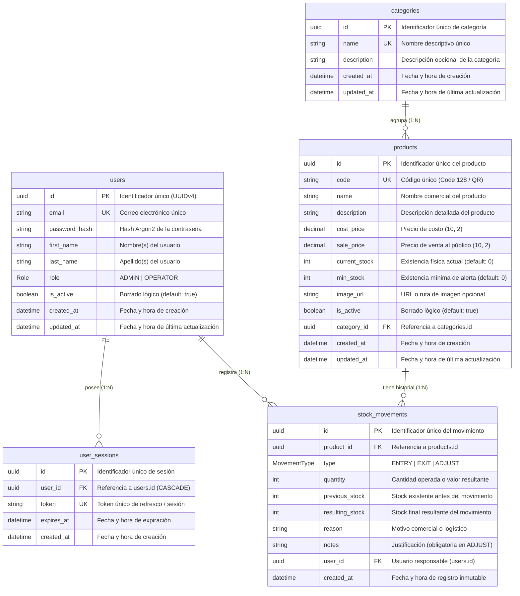

# Modelo de Datos y Esquema de Persistencia

Este documento describe el modelo de datos relacional del Sistema de Inventario implementado con **PostgreSQL** y **Prisma ORM**.

---

## 1. Diagrama Entidad-Relación (ERD)

---

## 2. Tipos Enumerados (Enums)

### 2.1. `Role`
Define el nivel de autorización y acceso a los endpoints y vistas del sistema:
- `ADMIN`: Administrador del sistema. Posee control absoluto sobre usuarios, roles, catálogo de productos, categorías y auditoría de inventario.
- `OPERATOR`: Operador de bodega / almacén. Permite consultar existencias, buscar productos mediante escaneo de código de barras/QR, registrar entradas, salidas y conteos físicos (ajustes).

### 2.2. `MovementType`
Define la naturaleza de una transacción de inventario:
- `ENTRY`: Entrada de mercancía a almacén (ej. compras a proveedores, devoluciones de clientes). Incrementa `currentStock`.
- `EXIT`: Salida de mercancía (ej. ventas facturadas, mermas por vencimiento, descartes por daño físico). Decrementa `currentStock`. Requiere que la existencia previa sea suficiente para evitar existencias negativas.
- `ADJUST`: Ajuste por conteo físico o conciliación de inventario. Sobrescribe la existencia con el valor auditado y requiere justificación obligatoria en `notes`.

---

## 3. Especificación Detallada de Modelos

### 3.1. Modelo `User` (Tabla: `users`)
Almacena las credenciales y perfiles de los usuarios del sistema.

| Columna | Tipo Prisma / SQL | Restricciones | Descripción |
| :--- | :--- | :--- | :--- |
| `id` | `String` / `uuid` | `@id @default(uuid())` | Llave primaria UUID v4 |
| `email` | `String` / `varchar` | `@unique` | Correo electrónico institucional normalizado |
| `passwordHash` | `String` / `text` | `@map("password_hash")` | Hash criptográfico generado mediante Argon2id |
| `firstName` | `String` / `varchar` | `@map("first_name")` | Nombres del usuario |
| `lastName` | `String` / `varchar` | `@map("last_name")` | Apellidos del usuario |
| `role` | `Role` | `@default(OPERATOR)` | Rol en el sistema (`ADMIN` o `OPERATOR`) |
| `isActive` | `Boolean` | `@default(true) @map("is_active")` | Bandera de borrado lógico |
| `createdAt` | `DateTime` | `@default(now()) @map("created_at")` | Marca temporal de alta |
| `updatedAt` | `DateTime` | `@updatedAt @map("updated_at")` | Marca temporal de última edición |

**Reglas de negocio asociadas:**
- No se eliminan usuarios físicamente de la base de datos para preservar la trazabilidad histórica de los movimientos de stock que hayan ejecutado (`isActive: false`).
- Los usuarios inactivos (`isActive: false`) son rechazados en el middleware de autenticación (`401 Unauthorized`).

---

### 3.2. Modelo `UserSession` (Tabla: `user_sessions`)
Gestiona los tokens de refresco y la persistencia de sesiones activas.

| Columna | Tipo Prisma / SQL | Restricciones | Descripción |
| :--- | :--- | :--- | :--- |
| `id` | `String` / `uuid` | `@id @default(uuid())` | Llave primaria de sesión |
| `userId` | `String` / `uuid` | `@map("user_id")` | Llave foránea hacia `users.id` |
| `token` | `String` / `varchar(500)`| `@unique` | Token de refresco único e indexado |
| `expiresAt` | `DateTime` | `@map("expires_at")` | Expiración programada de la sesión |
| `createdAt` | `DateTime` | `@default(now()) @map("created_at")` | Fecha de emisión de la sesión |

**Reglas de negocio asociadas:**
- Relación `onDelete: Cascade`: Si el usuario fuese retirado, sus sesiones se purgan automáticamente.
- Cierre de sesión individual o global invalidando el registro en base de datos.

---

### 3.3. Modelo `Category` (Tabla: `categories`)
Agrupador taxonómico para productos y reportes de inventario.

| Columna | Tipo Prisma / SQL | Restricciones | Descripción |
| :--- | :--- | :--- | :--- |
| `id` | `String` / `uuid` | `@id @default(uuid())` | Llave primaria UUID v4 |
| `name` | `String` / `varchar` | `@unique` | Nombre único de la categoría |
| `description` | `String?` / `text` | Opcional | Información complementaria |
| `createdAt` | `DateTime` | `@default(now()) @map("created_at")` | Fecha de creación |
| `updatedAt` | `DateTime` | `@updatedAt @map("updated_at")` | Fecha de última edición |

**Reglas de negocio asociadas:**
- La eliminación física de una categoría requiere que no tenga productos asociados asignados.

---

### 3.4. Modelo `Product` (Tabla: `products`)
Entidad central que modela los artículos en inventario, su codificación escaneable y existencias.

| Columna | Tipo Prisma / SQL | Restricciones | Descripción |
| :--- | :--- | :--- | :--- |
| `id` | `String` / `uuid` | `@id @default(uuid())` | Llave primaria UUID v4 |
| `code` | `String` / `varchar` | `@unique`, Indexado | Código único alfanumérico para Code 128 y QR |
| `name` | `String` / `varchar` | Obligatorio | Nombre comercial del artículo |
| `description` | `String?` / `text` | Opcional | Especificaciones técnicas o notas |
| `costPrice` | `Decimal` / `decimal(10,2)`| `@map("cost_price")` | Costo unitario de adquisición |
| `salePrice` | `Decimal` / `decimal(10,2)`| `@map("sale_price")` | Precio de venta sugerido al público |
| `currentStock` | `Int` / `integer` | `@default(0) @map("current_stock")`| Existencia en almacén en tiempo real |
| `minStock` | `Int` / `integer` | `@default(0) @map("min_stock")`| Umbral mínimo para disparo de alertas |
| `imageUrl` | `String?` / `text` | `@map("image_url")`, Opcional | URL externa o relativa de imagen |
| `isActive` | `Boolean` | `@default(true) @map("is_active")` | Borrado lógico del catálogo |
| `categoryId` | `String` / `uuid` | `@map("category_id")` | Llave foránea hacia `categories.id` |
| `createdAt` | `DateTime` | `@default(now()) @map("created_at")` | Fecha de registro inicial |
| `updatedAt` | `DateTime` | `@updatedAt @map("updated_at")` | Última actualización |

**Índices:**
- `@@index([code])`: Búsqueda ultra-rápida ante escaneo masivo desde el lector de códigos de barras o cámara.

**Reglas de negocio asociadas:**
- **Inmutabilidad del Código:** El `code` es único globalmente y se genera mediante algoritmo anti-duplicados (ej. `PRD-X7K9M2`) o mediante entrada manual de código de barras comercial (EAN-13, Code 128).
- **Semántica de Código en Etiquetas:** El código QR y el código de barras en la etiqueta física codifican **exclusivamente el código del producto**, nunca el stock actual (el stock es dinámico y se consulta en la base de datos).
- **Borrado Lógico:** `DELETE /api/v1/products/:id` ejecuta `isActive = false`, manteniendo la integridad referencial en `stock_movements`.
- **Filtro de Stock Bajo:** Se evalúa con la condición `currentStock <= minStock AND isActive = true`.

---

### 3.5. Modelo `StockMovement` (Tabla: `stock_movements`)
Libro mayor (Ledger) inmutable que audita cada modificación de existencias.

| Columna | Tipo Prisma / SQL | Restricciones | Descripción |
| :--- | :--- | :--- | :--- |
| `id` | `String` / `uuid` | `@id @default(uuid())` | Llave primaria UUID v4 |
| `productId` | `String` / `uuid` | `@map("product_id")` | Producto afectado (`products.id`) |
| `type` | `MovementType` | `ENTRY` \| `EXIT` \| `ADJUST` | Clasificación de la operación |
| `quantity` | `Int` / `integer` | Valor absoluto operado | Cantidad ingresada, retirada o valor fijado |
| `previousStock`| `Int` / `integer` | `@map("previous_stock")` | Existencia antes de la operación |
| `resultingStock`| `Int` / `integer` | `@map("resulting_stock")` | Existencia consolidada resultante |
| `reason` | `String` / `varchar` | Obligatorio | Motivo comercial (ej. Venta, Compra, Merma) |
| `notes` | `String?` / `text` | Condicional | Justificación obligatoria en caso de `ADJUST` |
| `userId` | `String` / `uuid` | `@map("user_id")` | Responsable que ejecutó la operación |
| `createdAt` | `DateTime` | `@default(now()) @map("created_at")` | Marca temporal inmutable |

**Índices:**
- `@@index([productId])`: Optimiza el cálculo del historial y kárdex por producto.
- `@@index([createdAt])`: Optimiza reportes y exportación cronológica de auditoría a CSV.

**Reglas de negocio asociadas:**
- **Atomicidad Transaccional:** La inserción del movimiento y la actualización del campo `currentStock` en `Product` se realizan dentro de una transacción aislada de base de datos (`prisma.$transaction`).
- **Inmutabilidad Absoluta:** No existen endpoints de edición (`PUT`/`PATCH`) ni de eliminación (`DELETE`) para movimientos de inventario.
- **Validación de Sobregiro:** En movimientos `EXIT`, el sistema valida que `previousStock >= quantity`. En caso contrario, se lanza un error de negocio (`AppError(400, "Existencias insuficientes")`).
